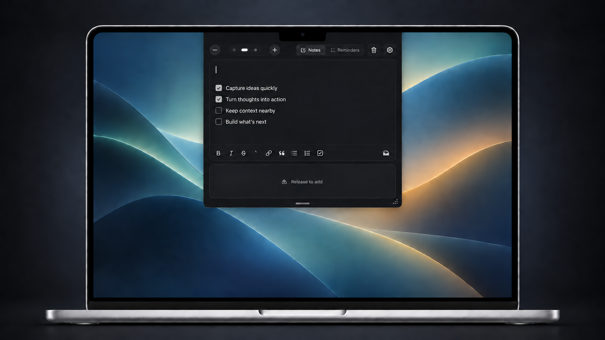

<p align="center">
  
</p>

# YUANNotch

一款藏在 Mac 屏幕顶部、尽量不打扰你的桌面记录与提醒应用。

YUANNotch 的出发点，是让记录尽可能自然、无感：平时安静地留在屏幕顶部，需要时随手展开，用完便回到正在做的事情里。它不是一个庞大的知识库或任务管理系统，而是一个始终在手边的入口——接住突然出现的想法、眼前要做的事，以及工作中需要反复查看的内容。

<p align="center">
  
</p>

## 核心功能

### 顶部常驻，随时展开

YUANNotch 常驻在屏幕顶部中央，通过悬停或点击即可打开；面板可以拖出成为独立的悬浮窗口，也可以双击或拖回顶部自动归位。支持多显示器，并可在设置中调整触发方式、响应延迟、外观和开机启动。

### 本地 Markdown 笔记

在 Notes 中快速创建和切换多个页面，内容以独立 Markdown 文件保存在本地。笔记目录可以指定为自己的文件夹或 Obsidian 仓库，粘贴的图片会保存到同目录的 `attachments` 文件夹，方便继续使用现有的文件工作流。

### Apple 提醒事项

在 Reminders 中直接切换提醒事项列表，创建、编辑、设置到期时间并完成提醒。数据由 macOS Reminders 管理；选择 iCloud 列表后，提醒会继续通过 Apple 的服务同步到其他设备。

### 每日计划与番茄钟

在 Plans 中建立可重复的每日时长目标，为每个计划设置专属的专注与休息节奏。支持开始、暂停和切换计划，显示当前番茄轮次、当天累计进度，并保留历史完成记录；收起面板或切换到其他页面不会中断计时。

### 文件暂存区

将文件拖到顶部区域或展开的面板即可暂存，之后再拖到 Finder、其他应用或网页上传区域。暂存区支持排序和多选操作，只保存文件位置，不会移动、复制或删除原文件。

### 本地优先与可控的数据

YUANNotch 不要求账户，也不提供自有云端同步。笔记、图片、计划和计时状态保存在本机；提醒事项直接使用系统数据。你可以在设置中更改笔记目录，并单独启用或关闭文件暂存区和提醒事项集成。

## 如何使用

### 打开面板

默认情况下，把鼠标停在屏幕顶部中央即可展开 YUANNotch。也可以在 **设置 → Trigger** 中改为点击打开，并调整悬停触发的等待时间。

### 记录、提醒与每日计划

在 Notes 页面直接输入即可开始记录；使用左上方的 `+` 和 `−` 新建或移除笔记页面。切换到 Reminders 页面后，可以查看、创建和完成 Apple 提醒事项。第一次启用时，需要在 **设置 → Integrations** 中打开同步，并授予系统提醒事项权限。

Reminders 条目中的日期可以直接点击修改；无日期条目在悬停时显示日历按钮。日期编辑支持今天、明天、自选日期和可选时间，关闭 **Due date** 后保存可清除日期及提醒。保存后会更新 Apple 提醒事项，并同步调整本地列表的日期分组和排序；取消不会写入，保存失败则保留草稿供重试。

创建单次提醒时，可直接输入“28号晚上10点买药”“明天上午九点半开会”或“半小时后取快递”。输入框保留原文，日期和时间按钮显示识别结果，下方预览将保存的标题；回车或点击 Add 后创建。支持句首或句尾的常见中文日期、星期、中文数字及相对时间，省略月份的“28号”取最近一次有效日期。可以点击日期／时间按钮手动覆盖，或选择 **按原文** 保留完整文字。无效日期、已过时间、多个时间和重复表达会提示，不会悄悄创建；当前不支持重复提醒。相对时间在识别时确定为绝对时间，预览、创建与失败重试保持一致。

在 Plans 页面点击 **Add Daily Plan** 可以设置目标时长、启用日期和番茄钟节奏。点击计划右侧的播放按钮开始计时；Today 会把当前倒计时固定在计划列表上方，并显示当天整体与单项进度。专注阶段计入每日目标，休息阶段不计入。

Plans 以本地时间每天 **04:00** 为新一天的起点，00:00–03:59 的专注仍计入上一日。到点后会结算上一日的专注时间、归零新一天的进度，并结束所有运行及暂停的计时，让全部计划回到收起的列表状态；不会自动开始新一轮。电脑睡眠或应用退出期间错过刷新，会在唤醒或下次启动后补做，计时只结算到错过的第一个 04:00。历史记录保留不清空，Today、启用日期和 History 使用同一日界线。

点击 Today 总进度旁的铅笔，或 History 中的历史日期，可以按计划修改当天的学习时长（小时和分钟）；额外的学习时间可填入 **Other focus**。保存后总时长、单项进度和历史日历同步更新，已删除计划的历史记录也可以修改。未修改的记录保留原有秒数，番茄钟保持当前节奏；连续计时按修正后的剩余目标更新倒计时，达到目标时结束。每日合计最多 24 小时，未来日期不可编辑。

### 调整字号

在 **设置 → Appearance → Text** 中，界面字号可选择 Compact、Standard 或 Larger；笔记正文可独立设置为 12–24 pt，默认 15 pt。修改即时生效，重启后保留，面板尺寸仍由你自己调整。

在笔记正文中编辑时，使用 **⌘+**（也支持 **⌘=**）放大、**⌘−** 缩小，**⌘0** 恢复 15 pt。这只调整显示字号，不改变 Markdown 内容；提醒事项、设置和其他输入框不会响应这些笔记快捷键。

### 使用暂存区

暂存区默认启用，但没有文件时不会一直占用面板空间。将文件拖到屏幕顶部的 YUANNotch 区域或已经展开的面板，暂存区会自动出现。之后可以把文件从暂存区直接拖入其他应用；有暂存内容时，也可以点击编辑区下方的托盘图标收起或重新展开。

如果暂存区已被关闭，可以前往 **设置 → File Shelf**，打开 **Enable file shelf**。

### 拖出浮动与自动归位

- **拖出浮动：** 按住面板底部中央的灰色短线，向下拖动，面板就会脱离屏幕顶部，成为可以自由移动的悬浮窗口。
- **自动归位：** 双击灰色短线，或者把悬浮窗口拖到屏幕顶部，面板都会自动吸附回原位。

## 下载

[下载最新版本](https://github.com/Hy0IU/YUANNotch/releases/latest)

目前支持 macOS 14 或更高版本，以及 Apple Silicon Mac。

优先下载 Release 中的 DMG 安装包，双击打开后，按窗口中的箭头将 YUANNotch 拖到右侧的 Applications（应用程序）图标。复制完成后，从“应用程序”打开 YUANNotch，再推出安装镜像。如果下载的是旧版本 ZIP，请解压后将应用拖入“应用程序”。

DMG 提供安装引导窗口；是否通过 macOS 安全检查还取决于应用签名和 Apple 公证。当前本地打包默认使用临时签名，不包含 Apple 公证。

## 数据与隐私

笔记以普通 Markdown 文件保存在本机，图片也存放在同一个笔记目录中。每日计划、计时状态和完成进度保存在应用的本地 Application Support 目录。提醒事项直接读写 macOS 的系统提醒数据库。YUANNotch 不提供自己的账户、云端或同步服务。

## 从源码构建

需要 macOS 14+ 和 Swift 6：

```bash
git clone https://github.com/Hy0IU/YUANNotch.git
cd YUANNotch
bash Scripts/package-app.sh
```

## 制作发布安装包

当前版本为 **1.0.1**，构建号为 **14**。发布脚本默认生成 DMG 和 SHA-256 校验文件，放在 `.release/`，不会替换 `/Applications` 中正在使用的应用。传入计划发布的版本号和递增构建号，例如：

```bash
bash Scripts/make-release.sh 1.0.1 14
```

DMG 内含应用、Applications 链接和安装引导背景，挂载时会请求 Finder 打开安装窗口。布局工具直接生成镜像元数据，不需要控制 Finder，也不需要安装额外依赖。脚本同时生成 `*-preview.png` 合成效果图，便于检查设计；它不是 Finder 实际截图。

如需同时保留 ZIP 下载，设置 `INCLUDE_ZIP=1`：

```bash
INCLUDE_ZIP=1 bash Scripts/make-release.sh 1.0.1 14
```

正式分发时，使用有效的 Developer ID Application 证书和已经配置好的 `notarytool` 钥匙串配置：

```bash
SIGN_IDENTITY='Developer ID Application: …' \
NOTARY_PROFILE='your-notary-profile' \
bash Scripts/make-release.sh 1.0.1 14
```

脚本会签名应用和 DMG，等待 Apple 公证、附加并验证公证票据，最后计算校验值；任一步骤失败都会停止。仅设置 `SIGN_IDENTITY` 不会自动公证。启用 ZIP 时，也会公证并附加 ZIP 内应用的票据。

发布前可校验压缩镜像、应用签名、Finder 布局、重新挂载后的背景引用和自动打开标记：

```bash
bash Scripts/dmg-probe.sh .release/YUANNotch-1.0.1.dmg
(cd .release && shasum -a 256 -c YUANNotch-1.0.1.dmg.sha256)
```

最后在目标 macOS 上双击 DMG，检查 Finder 实际显示和拖拽安装，再将 DMG 与校验文件上传到对应的 GitHub Release。

## 致谢

- [swift-markdown-engine](https://github.com/nodes-app/swift-markdown-engine) 提供 Markdown 编辑器内核。
- [Atoll](https://github.com/Ebullioscopic/Atoll) 为 macOS 顶部面板的交互与实现提供了参考。
